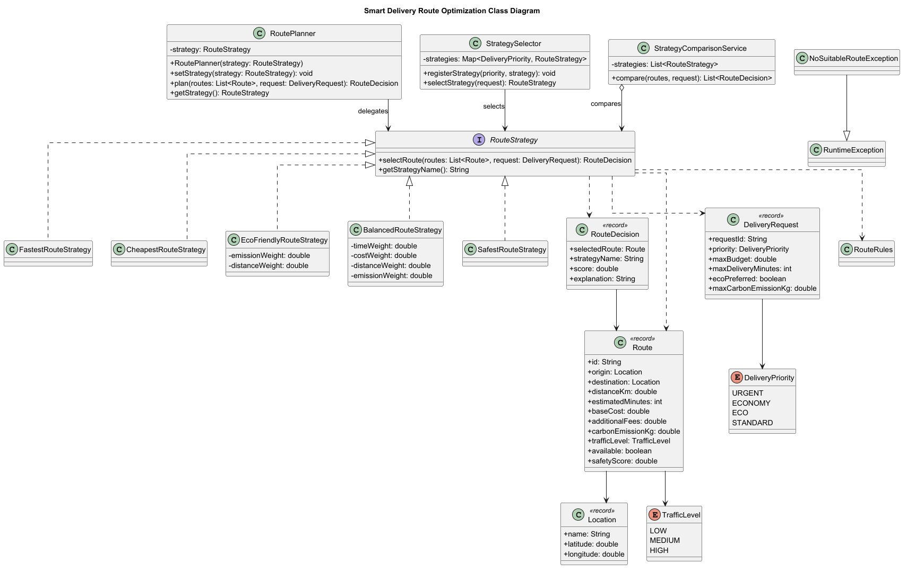
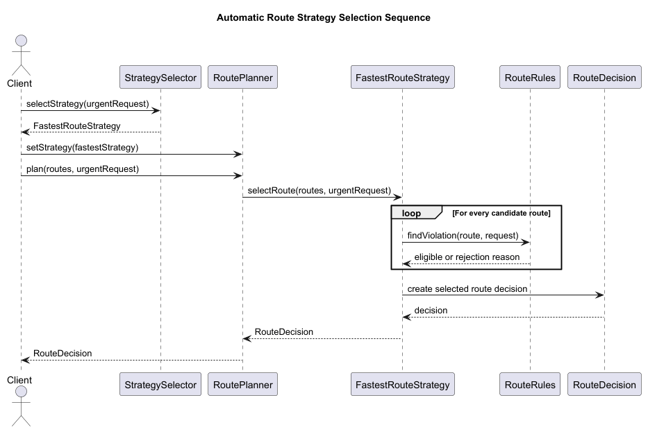

# Smart Delivery and Route Optimization Engine

A Java 17 application demonstrating the Strategy design pattern through a smart delivery route optimization system.

The application selects delivery routes using interchangeable algorithms based on time, cost, distance, carbon emissions and safety.

## Author

Vilgelm Feller

## Technologies

- Java 17
- Maven
- JUnit 5
- PlantUML
- Strategy Design Pattern

## Project Scenario

A logistics company needs different methods for selecting delivery routes. An urgent delivery should prioritize time, an economy delivery should prioritize cost, and an eco-friendly delivery should minimize environmental impact.

The Strategy pattern allows the application to change the route-selection algorithm without changing the `RoutePlanner` class.

## Architecture

The project contains the following Strategy pattern participants:

- **Context:** `RoutePlanner`
- **Strategy:** `RouteStrategy`
- **Concrete Strategies:**
    - `FastestRouteStrategy`
    - `CheapestRouteStrategy`
    - `EcoFriendlyRouteStrategy`
    - `BalancedRouteStrategy`
    - `SafestRouteStrategy`
- **Automatic selector:** `StrategySelector`
- **Strategy comparison:** `StrategyComparisonService`

`RoutePlanner` depends only on the `RouteStrategy` abstraction. It delegates route selection to the currently configured strategy.

## Domain Model

The main domain classes are:

- `Location` — delivery location and coordinates.
- `Route` — distance, time, cost, emissions, traffic, availability and safety.
- `DeliveryRequest` — priority, budget, deadline and emission restrictions.
- `RouteDecision` — selected route, strategy name, score and explanation.
- `DeliveryPriority` — `URGENT`, `ECONOMY`, `ECO`, `STANDARD`.
- `TrafficLevel` — `LOW`, `MEDIUM`, `HIGH`.

The demonstration contains eight candidate routes.

## Strategy Algorithms

### Fastest Route Strategy

Final delivery time is calculated using:

```text
finalTime = estimatedMinutes + trafficPenalty
```

The available route with the lowest final time is selected.

### Cheapest Route Strategy

Total cost is calculated using:

```text
totalCost =
baseCost
+ distance × 50
+ prioritySurcharge
+ additionalFees
```

The route with the lowest valid total cost is selected.

### Eco-Friendly Route Strategy

```text
ecoScore =
carbonEmission × 0.70
+ distance × 0.30
```

The route with the lowest environmental score is selected.

### Balanced Route Strategy

```text
score =
normalizedTime × timeWeight
+ normalizedCost × costWeight
+ normalizedDistance × distanceWeight
+ normalizedEmission × emissionWeight
```

Default weights:

```text
Time:      0.40
Cost:      0.30
Distance:  0.10
Emission:  0.20
Total:     1.00
```

Invalid weight configurations are rejected.

### Safest Route Strategy

The route with the highest safety score is selected. If two routes have the same safety score, the faster route is selected.

This fifth strategy was introduced after the initial implementation without modifying `RoutePlanner`.

## Hard Constraints

A route is rejected when:

- it is unavailable;
- its total cost exceeds the maximum budget;
- its final delivery time exceeds the deadline;
- its carbon emissions exceed the permitted limit.

If no valid route exists, the application throws `NoSuitableRouteException`. It never returns an unexplained `null`.

## Runtime Strategy Switching

The same `RoutePlanner` object works with different algorithms:

```java
RoutePlanner planner =
        new RoutePlanner(new FastestRouteStrategy());

planner.plan(routes, request);

planner.setStrategy(new CheapestRouteStrategy());
planner.plan(routes, request);

planner.setStrategy(new EcoFriendlyRouteStrategy());
planner.plan(routes, request);

planner.setStrategy(new BalancedRouteStrategy());
planner.plan(routes, request);
```

This demonstrates at least three runtime strategy switches.

## Automatic Strategy Selection

`StrategySelector` uses an `EnumMap` instead of a large conditional statement:

| Delivery priority | Selected strategy |
|---|---|
| `URGENT` | `FastestRouteStrategy` |
| `ECONOMY` | `CheapestRouteStrategy` |
| `ECO` | `EcoFriendlyRouteStrategy` |
| `STANDARD` | `BalancedRouteStrategy` |

`StrategySelector` decides which strategy should be used. The selected strategy decides how the route should be chosen.

## Strategy Comparison Mode

`StrategyComparisonService` executes all five strategies for the same request. This demonstrates that the same problem can be solved using interchangeable algorithms.

Example result:

```text
Fastest Route Strategy  -> Route B
Cheapest Route Strategy -> Route C
Eco-Friendly Strategy   -> Route H
Balanced Route Strategy -> Route C
Safest Route Strategy   -> Route H
```

## UML Diagrams

### Class Diagram



### Sequence Diagram



## Testing

The project contains 20 meaningful JUnit 5 tests.

The tests cover:

- all five strategies;
- traffic penalties;
- runtime strategy switching;
- automatic strategy selection;
- unavailable routes;
- budget restrictions;
- deadline restrictions;
- emission restrictions;
- invalid Balanced Strategy weights;
- empty route lists;
- no valid route scenarios;
- comparison mode;
- boundary values;
- invalid domain data.

Test result:

```text
Tests run: 20
Failures: 0
Errors: 0
```

## Example Console Output

```text
=== SMART DELIVERY ROUTE OPTIMIZATION ===

Fastest Route Strategy:
Selected route: Route B
Time: 20 minutes

Cheapest Route Strategy:
Selected route: Route C
Cost: 1800.00

Eco-Friendly Route Strategy:
Selected route: Route H
CO2: 0.60 kg

Balanced Route Strategy:
Selected route: Route C
Score: 0.552

Safest Route Strategy:
Selected route: Route H
Safety score: 9.20
```

## Assignment Questions

### 1. What problem does Strategy solve in this project?

Strategy separates route-selection algorithms from `RoutePlanner`. It prevents the Context from becoming a large collection of `if`, `switch` and `instanceof` conditions.

### 2. Where is the Context?

`RoutePlanner` is the Context. It stores a `RouteStrategy` and delegates route selection to it.

### 3. Where is the Strategy interface?

`RouteStrategy` is the Strategy interface. It declares `selectRoute()` and `getStrategyName()`.

The interface returns `RouteDecision` instead of only `Route` so that every strategy can explain its result.

### 4. What are the Concrete Strategies?

The Concrete Strategies are `FastestRouteStrategy`, `CheapestRouteStrategy`, `EcoFriendlyRouteStrategy`, `BalancedRouteStrategy` and `SafestRouteStrategy`.

### 5. Where is runtime strategy switching demonstrated?

Runtime switching is demonstrated in `Main` using `RoutePlanner.setStrategy()`.

### 6. Why is this Strategy rather than simple if/else?

Each algorithm is located in a separate class implementing the same interface. `RoutePlanner` does not inspect strategy types or select algorithms using conditional statements.

### 7. How can a new Strategy be added?

Create a new class that implements `RouteStrategy`. The `RoutePlanner` class does not need to be modified.

### 8. What is the difference between Strategy and Bridge?

Strategy changes the algorithm used by one Context. In this project, it changes how a route is selected.

Bridge separates two independent class hierarchies. In the previous notification project, notification types and message providers could evolve independently.

### 9. Which SOLID principles are demonstrated?

- **SRP:** planning, algorithms, automatic selection and comparison have separate responsibilities.
- **OCP:** new strategies can be added without modifying `RoutePlanner`.
- **DIP:** `RoutePlanner` depends on the `RouteStrategy` abstraction rather than concrete strategies.

### 10. What limitation does the current architecture have?

The project uses demonstration data stored in memory. It does not use real traffic, weather, mapping or logistics APIs. Strategy weights and pricing values are also configured manually.

## Running the Project

Run the application:

```text
src/main/java/com/example/delivery/Main.java
```

Run tests through IntelliJ IDEA or Maven:

```bash
mvn clean test
```